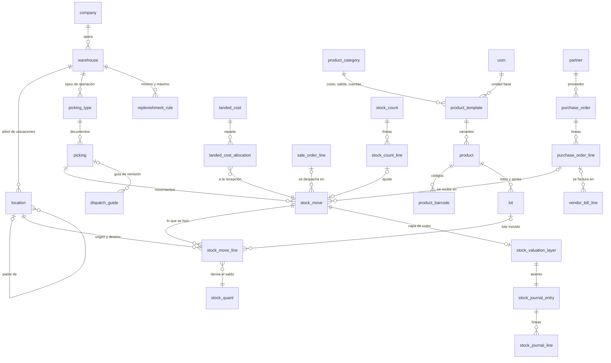

# Esquema de referencia

`logistica_schema.sql`: esquema PostgreSQL 15+ de inventario, valorización, almacén, compras, pedidos y
transporte, en el schema `scm`, pensado para un ERP multitenant con una base de datos por tenant.
58 tablas. Es el modelo contra el que se comparan los diseños concretos: un producto puede implementar
un subconjunto, pero con la misma forma
([patrones.md › 16](../patrones.md#16-el-mínimo-viable-es-un-subconjunto-del-modelo-completo)).

## Secciones

| Sección | Contenido |
|---|---|
| 0 | Catálogos genéricos y políticas del tenant (`scm_setting`) |
| 1 | Empresa, establecimiento, almacén, ubicaciones (físicas y virtuales), numeración |
| 2 | Catálogo: unidades y conversiones, categorías (método de costo, salida, cuentas), plantilla, variante, códigos, empaques, kits |
| 3 | Terceros y condiciones del proveedor con vigencia |
| 4 | Lotes, series y paquetes |
| 5 | Operaciones: tipos de operación, documentos (`picking`), movimientos, líneas, quants |
| 6 | Valorización: capas de costo y costos de importación |
| 7 | Conteos |
| 8 | Compras: órdenes, facturas de proveedor, reglas de reposición |
| 9 | Pedidos de venta y devoluciones (RMA) |
| 10 | Almacén dirigido: reglas de ubicación, olas, tareas |
| 11 | Transporte y guías de remisión |
| 12 | Asientos de inventario |
| 13 | Cierre de inventario y aprobaciones |
| 14 | Auditoría |
| 16 | Lógica: ubicaciones, unidades y numeración, cierre, quants, estados del movimiento, reservas, valorización, costos de importación, conteos, compras, asientos |
| 15 | Vistas: disponibilidad, kits, kardex, valorización, conciliación contable, partida doble, vencimientos, series, reposición, tres vías |

Las tablas llevan `[MVP]` o `[F2]` en su comentario: con las `[MVP]` alcanza para un primer inventario
real; las `[F2]` se agregan sin romper el diseño.

## Diagrama entidad-relación (núcleo)



## Cargarlo y probarlo

```bash
createdb lg_ref
psql -v ON_ERROR_STOP=1 -d lg_ref -f logistica_schema.sql
psql -d lg_ref -f pruebas/smoke.sql         # unidades, recepción, disponibilidad, garantías, idempotencia, lotes
psql -d lg_ref -f pruebas/valorizacion.sql  # los ejemplos de inventario/valorizacion.md
psql -d lg_ref -f pruebas/operacion.sql     # conteo en marcha, aprobación de OC, recepción parcial, tres vías, reposición
```

Resultado esperado (verificado el 2026-10-16 en PostgreSQL 16):
- `smoke.sql`: 2 cajas = 24 unidades a 10.0000; disponibilidad 120 / 30 / 90 / 50 / 45 / 125 / 75 como en
  `inventario/motor.md`; cinco garantías responden con su código; la venta del POS reenviada crea un
  solo movimiento; el piso de venta queda en −3; la partida doble suma cero y los quants se reconstruyen
  sin diferencias; FEFO reserva 10 del lote de noviembre y 2 del de diciembre, nunca el vencido.
- `valorizacion.sql`: kardex de A idéntico al del documento; costo de ventas 2,023.64 (promedio),
  2,010.00 (PEPS) y 2,070.00 con variación −35.00 (estándar); devolución a 11.0000 y nuevo promedio
  11.6060; diferencia de factura 24.00 a inventario y 16.00 a costo de ventas; flete 75.00 y 225.00
  (costos 10.7500 y 24.5000); corrección de stock negativo −10.00 (saldo 20 a 12.0000); capas =
  contabilidad; movimiento en mes cerrado rechazado.
- `operacion.sql`: conteo con diferencia −1 (saldo 44); `PO_APPROVAL_REQUIRED` y `PO_SELF_APPROVAL`;
  pendiente de 20 tras recibir 80; tres vías `price_mismatch` y `ok`; sugerencia de reposición 900.

Las pruebas usan datos ficticios y se pueden correr en ese orden sobre una base limpia.

## Qué hace cumplir la base

| Código | Regla |
|---|---|
| `RESERVE_EXCEEDS_STOCK`, `RESERVE_LOCATION_INVALID` | Una reserva no supera lo físico y solo toma ubicaciones internas no bloqueadas |
| `STOCK_NEGATIVE_NOT_ALLOWED` | Stock negativo solo donde la ubicación lo admite (piso de venta) o con permiso puntual |
| `MOVE_DONE_IMMUTABLE`, `MOVE_LINE_IMMUTABLE`, `MOVE_DELETE_FORBIDDEN` | Lo hecho no se edita ni se borra |
| `MOVE_INVALID_TRANSITION`, `MOVE_NO_DONE_LINES` | Estados del movimiento |
| `LOT_REQUIRED`, `SERIAL_QTY_ONE`, `LOT_PRODUCT_MISMATCH` | Lote o serie al mover productos con seguimiento |
| `UOM_CATEGORY_MISMATCH` | Conversión solo entre unidades de la misma categoría |
| `VALUATION_IMMUTABLE` | Una capa de costo no cambia; se corrige con otra |
| `INVENTORY_PERIOD_LOCKED`, `LOCK_REASON_REQUIRED` | Nada con fecha del período cerrado; reabrir exige motivo |
| `PO_APPROVAL_REQUIRED`, `PO_SELF_APPROVAL` | Aprobación de compras por monto, por otra persona |
| Exclusión en `supplier_info` | Un solo precio vigente por proveedor, producto y cantidad mínima |

## Qué tablas lee y escribe cada proceso

| Proceso | Lee | Escribe |
|---|---|---|
| Recibir una compra | `purchase_order_line`, `product`, `uom` | `picking`, `stock_move`, `stock_move_line`, `stock_quant`, `stock_valuation_layer`, asiento |
| Reservar un pedido | `stock_quant`, `lot`, `product_category` (estrategia) | `stock_move_line` reservadas, `stock_quant.reserved_quantity` |
| Despachar o vender | Reservas, `stock_quant` | Líneas hechas, quants, capa de salida, asiento |
| Recibir ventas del POS | Efectos de stock del POS (clave externa) | `stock_move` idempotente por `external_key` |
| Contar | `stock_quant`, líneas hechas desde la foto | `stock_count_line`, movimiento de ajuste |
| Aplicar flete o diferencia de factura | Capa de entrada y su `remaining_qty` | Capa de ajuste, asiento |
| Sugerir reposición | `v_stock_availability`, `replenishment_rule`, `supplier_info` | Órdenes de compra |
| Cerrar el mes | `v_valuation_check`, `v_quant_zero_sum` | `inventory_lock` |

## Lo que el esquema todavía no tiene

| Falta | Para qué | Propuesta |
|---|---|---|
| Costo por almacén | Margen real por tienda | Clave de valorización (empresa, almacén) en las capas |
| Corrección de stock negativo en PEPS | Hoy solo el promedio corrige el costo provisional | Capas negativas pendientes que la entrada siguiente compensa |
| Reservas por canal | Stock de seguridad para la tienda frente a la web | `channel_allocation` por almacén y producto |
| Ensamble y listas de materiales | Kits armados antes de vender, manufactura ligera | `bom`, `production_order` |
| Rutas en varios pasos automáticas | Recepción en tres pasos y despacho en tres pasos generados solos | Reglas de ruta que creen los movimientos encadenados (`move_dest_id`) |
| Clasificación ABC persistida | Frecuencia de conteo y nivel de servicio | `product_abc_class` por almacén y período |
| Envío de la guía de remisión | Estado ante la autoridad | Igual que `fiscal_submission` en el esquema de POS |
| Bitemporalidad | Qué creyó el sistema en cada fecha | Igual que en hr-knowledge: `recorded_from`, `recorded_to` |
