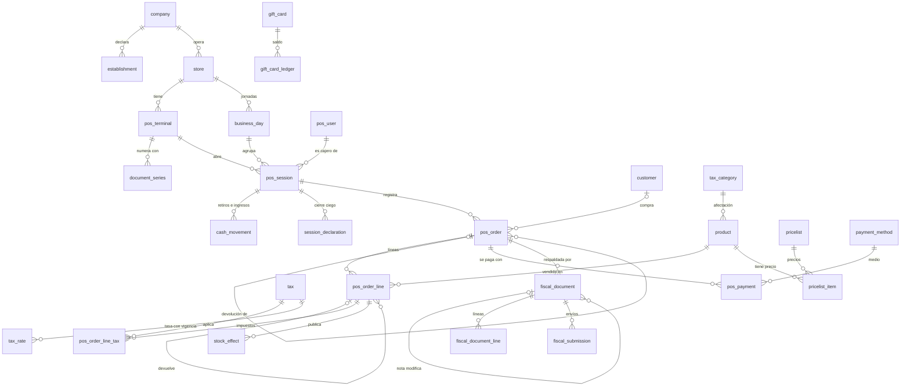

# Esquema de referencia

`pos_schema.sql`: esquema PostgreSQL 15+ del servidor de un POS, en el schema `pos`, pensado para un ERP
multitenant con una base de datos por tenant. 57 tablas. Es el modelo contra el que se comparan los
diseños concretos: un producto puede implementar un subconjunto, pero con la misma forma
([patrones.md › 15](../patrones.md#15-el-mínimo-viable-es-un-subconjunto-del-modelo-completo)).

La caja tiene su propia base local (catálogo, sesión, cola de salida); este esquema es el del servidor,
que recibe lo que la caja vendió, lo valida y lo distribuye ([offline-y-dispositivos.md](../offline-y-dispositivos.md)).

## Secciones

| Sección | Contenido |
|---|---|
| 0 | Catálogos genéricos, políticas del tenant (`pos_setting`), parámetros legales con vigencia, versión de maestros |
| 1 | Empresa, establecimiento, tienda, caja (`pos_terminal`), series de comprobantes, usuarios y topes por rol |
| 2 | Catálogo de venta: categorías, unidades, categorías de afectación, productos, códigos, kits |
| 3 | Impuestos: impuesto, tasa con vigencia por país o por empresa, impuestos por categoría y por producto |
| 4 | Listas de precios con vigencia y por cantidad, medios de pago, promociones, cupones |
| 5 | Clientes, cuenta corriente y tarjetas de regalo (libros mayores) |
| 6 | Medios de pago por tienda |
| 7 | Caja: día de negocio, sesión, historial de estados, movimientos de efectivo, declaraciones del cierre |
| 8 | Ventas: cabecera, líneas, impuestos y promociones por línea, pagos, excepciones de sincronización |
| 9 | Comprobantes: documento, líneas, envíos, resumen diario |
| 10 | Stock: efectos que se publican a inventario y réplica del disponible |
| 11 y 12 | Conciliación de tarjetas, asiento de la sesión, comisiones |
| 14 | Auditoría |
| 16 | Lógica: utilidades (tasa, precio, día de negocio, redondeo), máquina de estados de la sesión, llegada y validación de ventas, comprobantes, tarjetas de regalo, asiento de la sesión |
| 15 | Vistas: cierre de sesión, devolvible por línea, comprobantes pendientes, huecos de numeración, saldos, ventas del día, cambios de catálogo |

Las tablas llevan `[MVP]` o `[F2]` en su comentario: con las `[MVP]` alcanza para una primera tienda real;
las `[F2]` se agregan sin romper el diseño.

## Diagrama entidad-relación (núcleo)



## Cargarlo y probarlo

```bash
createdb pos_ref
psql -v ON_ERROR_STOP=1 -d pos_ref -f pos_schema.sql
psql -d pos_ref -f pruebas/datos.sql       # bodega en Lima, cinco cajas, IGV, ICBPER, medios de pago
psql -d pos_ref -f pruebas/smoke.sql       # sesión, venta idempotente, comprobante, garantías, huecos, catálogo
psql -d pos_ref -f pruebas/peru.sql        # ticket de localizacion/peru.md, boleta > S/ 700, factura con RUC, IGV reducido
psql -d pos_ref -f pruebas/caja.sql        # cierre de caja-y-turnos.md, aprobación, venta tardía, asiento
psql -d pos_ref -f pruebas/devolucion.sql  # 3 × 2 prorrateado, nota de crédito, reglas de reembolso, tarjeta de regalo
```

Resultado esperado (verificado el 2026-10-16 en PostgreSQL 16):
- `smoke.sql`: B001-1 por 80.00 (base 67.80, IGV 12.20) con efecto de stock −2; la venta reenviada no
  se duplica; ocho garantías responden con su código; huecos 2, 3, 4 al llegar el B001-5; precio 40.00
  el 31/10 y 35.00 el 1/11.
- `peru.sql`: líneas 21.95/3.95, 6.23/1.12, 0.17/0.03 + ICBPER 0.50; B003-1 por 33.95 cobrado 33.90,
  vuelto 16.10; `FISCAL_CUSTOMER_ID_REQUIRED`, `FISCAL_FACTURA_REQUIRES_RUC`; F003-1 base 109.75 e IGV
  19.75; plazos 3 y 7 días; IGV 0.105 para la cevichería y 0.18 para la bodega.
- `caja.sql`: esperado 1,085.50 en efectivo, diferencia −5.50; cierre aprobado por el supervisor;
  depósitos 880.00 y 1,880.00; venta tardía aceptada con `late_after_close`; asiento 5,685.90 = 5,685.90.
- `devolucion.sql`: netos 26.67, 26.67, 26.66; BC05-1 por 26.67 que modifica B005-1; cinco reglas de
  devolución responden con su código; saldo de la tarjeta de regalo 20.00.

Las pruebas usan datos ficticios y se corren en ese orden, una vez por base limpia.

## Qué hace cumplir la base

| Código | Regla |
|---|---|
| `uq_session_active_terminal` | Una sola sesión activa por caja |
| `SESSION_NOT_OPEN`, `SESSION_CLOSED` | No se vende con la caja en apertura ni después del cierre; lo vendido antes del cierre que llega tarde se acepta y se marca |
| `SESSION_DECLARATION_MISSING`, `SESSION_DIFF_APPROVAL_REQUIRED`, `SESSION_SELF_APPROVAL` | Cierre ciego completo; diferencia fuera de tolerancia aprobada por otra persona |
| `ORDER_LOCKED`, `ORDER_TOTALS_MISMATCH`, `ORDER_LINE_TAX_MISMATCH` | Líneas solo en borrador; cabecera = líneas; base + impuesto = total |
| `ORDER_PAYMENT_MISMATCH`, `ORDER_CHANGE_INVALID`, `ORDER_ROUNDING_WITHOUT_CASH` | Pagos = total + redondeo; vuelto y redondeo solo en efectivo |
| `ORDER_FISCAL_DOCUMENT_REQUIRED` | Una venta termina con comprobante |
| `REFUND_*` | Devolución dentro de lo vendido, al neto pagado, al mismo medio; sin ticket, con supervisor |
| `FISCAL_*` | Serie de la caja, factura con RUC, boleta identificada sobre el umbral, nota que referencia un comprobante válido y no lo excede, comprobante inmutable |
| `GIFT_CARD_INSUFFICIENT` | El saldo de una tarjeta de regalo no queda negativo |
| Exclusión en `tax_rate`, `pricelist_item`, `legal_parameter` | Una sola tasa, precio o valor vigente a la vez |

## Qué tablas lee y escribe cada proceso

| Proceso | Lee | Escribe |
|---|---|---|
| Sincronizar maestros a la caja | `v_catalog_changes` desde el cursor de la caja | `pos_terminal.last_sync_version` |
| Abrir caja | `pos_terminal`, `business_day` | `pos_session`, `business_day` |
| Recibir una venta | `pos_session`, `pricelist_item`, `tax_rate` | `pos_order`, `pos_order_line`, `pos_order_line_tax`, `pos_payment` |
| Emitir comprobante | `pos_order`, `document_series`, `legal_parameter` | `fiscal_document`, `fiscal_document_line` |
| Enviar a la autoridad | `fiscal_document` | `fiscal_submission`, `fiscal_document.status` |
| Publicar stock | `pos_order_line`, `product_kit_line` | `stock_effect` |
| Cerrar caja | `fn_session_expected`, `cash_movement` | `session_declaration`, `pos_session` |
| Contabilizar la sesión | Ventas, impuestos, pagos, diferencias | `session_journal_entry`, `session_journal_line` |
| Devolver | `pos_order_line` original, `v_order_refundable` | `pos_order` de devolución, nota de crédito, `stock_effect` |

## Lo que el esquema todavía no tiene

| Falta | Para qué | Propuesta |
|---|---|---|
| Turno del cajero dentro de la sesión | Cajón compartido con cambio de cajero | `pos_shift` con arqueo de traspaso |
| Motor de promociones en la base | Validar que la promoción aplicada era la correcta | Hoy la base guarda reglas y traza; validar reglas exige replicar el motor de la caja |
| Comunicación de baja y resumen diario completos | Anular y declarar boletas | Completar `fiscal_daily_summary` con estados y respuesta |
| Contingencia fiscal | Comprobantes físicos cuando falla la emisión | Serie de contingencia y su informe |
| Fidelización | Puntos y niveles | `loyalty_account`, `loyalty_ledger` |
| Separados y anticipos | Pagos parciales antes de entregar | Venta con estado de anticipo y comprobante de anticipo |
| Modo restaurante | Mesas, comandas, cuentas divididas, propinas | `table`, `kitchen_ticket`, pedido abierto por mesa |
| Conciliación automática de tarjetas | Cruce con la liquidación del adquirente | Proceso que llene `card_settlement_line.matched_payment_id` |
